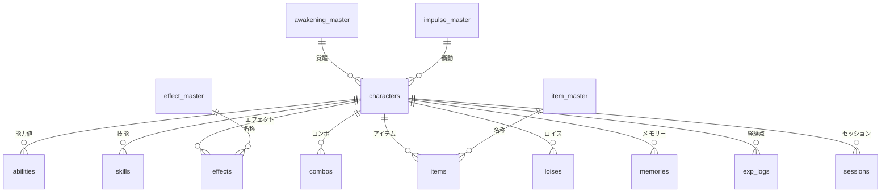

# DX3 キャラクターデータ パイプライン

TRPG「ダブルクロス The 3rd Edition」のキャラクターシート（テキスト）を Python で正規化して Excel のキャラ管理DBに取り込み、BigQuery に載せて SQL で集計するデータパイプラインです。

形式がそろっていないテキストを、品質チェック付きで分析用のテーブルにする。データ連携・移行の仕事で扱う流れを、題材を変えて作りました。

## 構成


| 段階 | やっていること | 使った技術 |
|---|---|---|
| 抽出・変換 | テキストをセクションごとに分解し、正規表現で値を取り出す。表記ゆれ（タイミングの略記、〈〉付きの技能名など）をそろえる | Python |
| 格納 | xlsx の列見出し名を見て書き込む。計算式・プルダウン・書式は壊さない | openpyxl |
| 検算 | テキストの HP・行動値などと、xlsx の計算式で出る値を突き合わせる | Python |
| 品質チェック | ID の重複・形式、親のない明細、能力値の件数、マスタ名称の重複を確認し、NG ならロードしない | pandas |
| ロード | 入力列だけを英語の列名で送る。WRITE_TRUNCATE で何度流しても同じ結果になる | google-cloud-bigquery |
| 集計 | xlsx の計算式を SQL で再現し、シンドローム別・エフェクト別などに集計する | BigQuery SQL |

## データモデル



- 明細テーブルはすべて `character_id` で `characters` につながります
- マスタは **名称だけをキー** にしています。同じエフェクトを別のキャラが持っていても1行で管理し、取り込みのたびに未登録の名称だけを追記します

## ビュー

| ビュー | 内容 | 使った SQL |
|---|---|---|
| `v_character_status` | HP最大値・行動値・戦闘移動・常備化ポイントなど、xlsx の計算式を SQL で再現 | 縦持ち→横持ち（`SUM(IF())`） |
| `v_syndrome_summary` | シンドロームごとのキャラ数 | `UNNEST` |
| `v_effect_cost` | キャラごとのエフェクト侵蝕値の合計 | `SAFE_CAST` |
| `v_skill_ranking` | 技能レベルのキャラ内順位 | `RANK()` ウィンドウ関数 |
| `v_effect_usage` | マスタの各エフェクトを何人が持っているか、平均・最大レベル | マスタ×明細の `LEFT JOIN` |

### ダッシュボード（Looker Studio）

!\[ダッシュボード1](docs/dashboard_1.png)  
!\[ダッシュボード2](docs/dashboard_2.png)  
\[レポートを開く](https://datastudio.google.com/s/pgVN0DDwznk)


## 設計のポイント

1. **冪等性（何度流しても同じ結果）**
   同じキャラ名を取り込み直すと、同じキャラIDのまま古い行を消して入れ直します。BigQuery 側も WRITE_TRUNCATE のロードジョブなので、失敗したら最初から流し直せばよい作りです。
2. **品質チェックで止める**
   ID の重複や親のない明細が1件でもあれば、BigQuery にはロードしません。壊れたデータを下流に流さないためです。
3. **二重計算による突き合わせ**
   計算列（HP最大値など）は BigQuery に送らず、ビューで計算し直しています。テキストの値・Excel の計算式・SQL の計算の3つが一致することを確認しました。
4. **1件の失敗で全体を止めない**
   フォルダ内の .txt を全件処理し、読めないファイルがあっても残りは取り込みます。最後に成功・失敗の件数を表示します。
5. **列は位置でなく見出し名で指定**
   xlsx の列が増えたり並びが変わったりしても、書き込み先がずれません。
6. **認証情報をリポジトリに置かない**
   BigQuery の認証は `gcloud auth application-default login` を使い、鍵ファイルは作っていません。

## 動かし方（Windows 11）

```powershell
# 準備（初回のみ）
python -m venv .venv
.\.venv\Scripts\Activate.ps1
pip install -r requirements.txt
gcloud auth application-default login

# 1. inputTxt\ の .txt をすべて xlsx に取り込む
python dx3_loader.py

# 2. 品質チェックだけ行い、送る予定のデータを output\ に CSV で出す
python dx3_to_bigquery.py --dry-run

# 3. BigQuery にロードし、ビューを作る
python dx3_to_bigquery.py
```

BigQuery はサンドボックス（クレジットカード登録なしの無料枠）で動かしています。

## フォルダ構成

```
dx3-data-pipeline/
├─ README.md
├─ requirements.txt
├─ dx3_loader.py           テキスト → xlsx
├─ dx3_to_bigquery.py      xlsx → BigQuery
├─ sql/                    ビューの定義（5本）
├─ DX3_キャラ管理DB.xlsx    取り込み先のテンプレート
└─ inputTxt/               キャラシートの .txt を置く
```

## 今後の改善点

- **自動実行**：GitHub Actions で、テキストを追加したら取り込みからロードまで自動で動かす
- **テスト**：解析処理を pytest で単体テストし、キャラシートの書式が変わったときに気づけるようにする
- **dbt への移行**：ビューの SQL を dbt のモデルにして、依存関係とテストを管理する
- **差分ロード**：今は毎回全件入れ替えなので、件数が増えたら更新分だけを送る形にする

## 背景

今まで携わった案件で「DataSpider」を使ったファイル連携、テスト、データ移行を担当してきました。その経験を、Python と SQL、クラウドのデータウェアハウスで一から組み直したのがこのリポジトリです。
